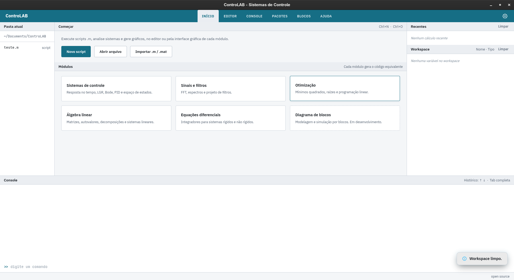

#  <strong>ControLAB — Suíte de Sistemas de Controle</strong>

---

  
   

---

## Instalação e Download

Para obter a versão mais recente, acesse a seção de [Releases no GitHub](https://github.com/enthonyaraujo/controlab/releases) e baixe o pacote correspondente ao seu sistema operacional:

- **Windows:** Instalador local único (`.exe` NSIS). Instala a aplicação diretamente no sistema operacional, criando atalhos oficiais na Área de Trabalho e no Menu Iniciar, com suporte nativo a desinstalação pelo Painel de Controle.
- **Linux:** Pacotes nativos Debian/Ubuntu (`.deb`), Fedora/RedHat/openSUSE (`.rpm`) e pacote universal autônomo (`.AppImage`).
- **Android:** Aplicativo nativo compilado em pacote (`.apk`) com motor Python embutido via Chaquopy, funcionando 100% offline no celular ou tablet.
  
---
