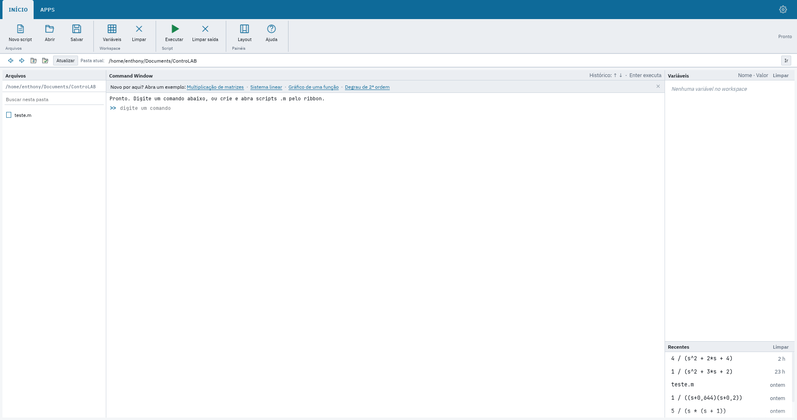
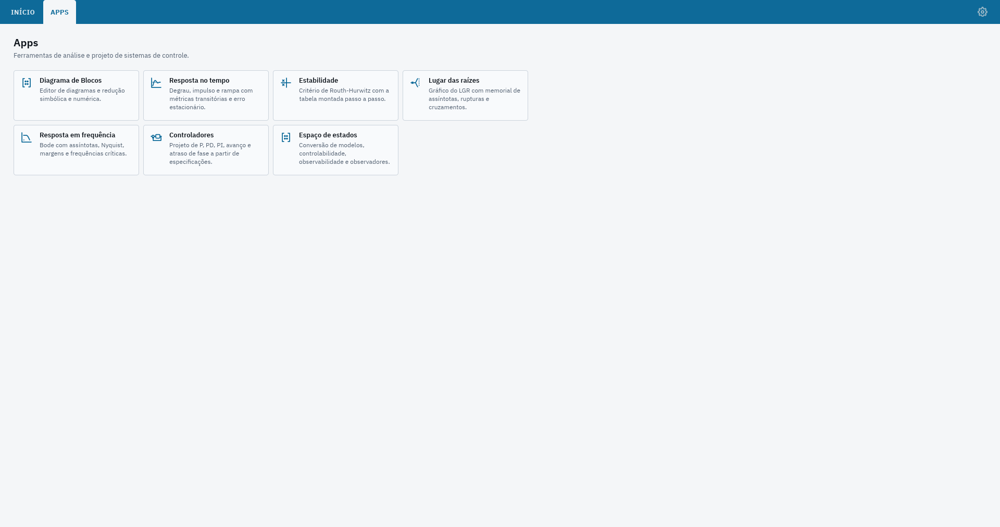
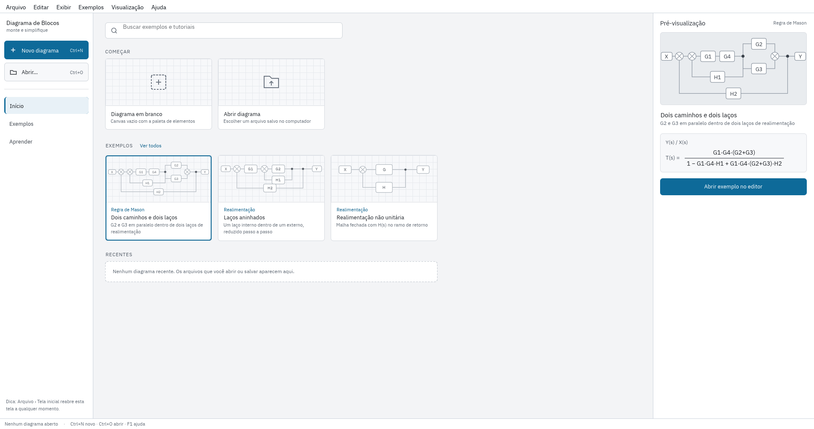
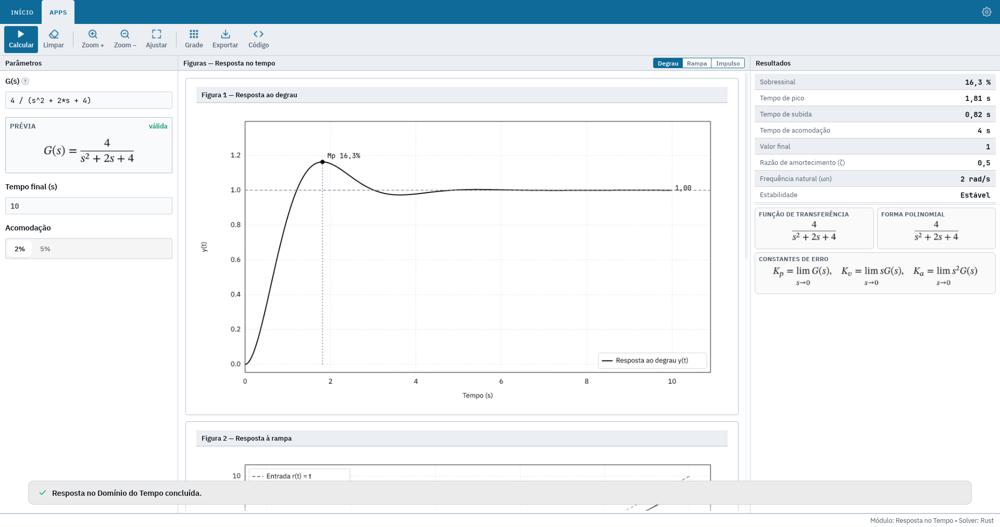
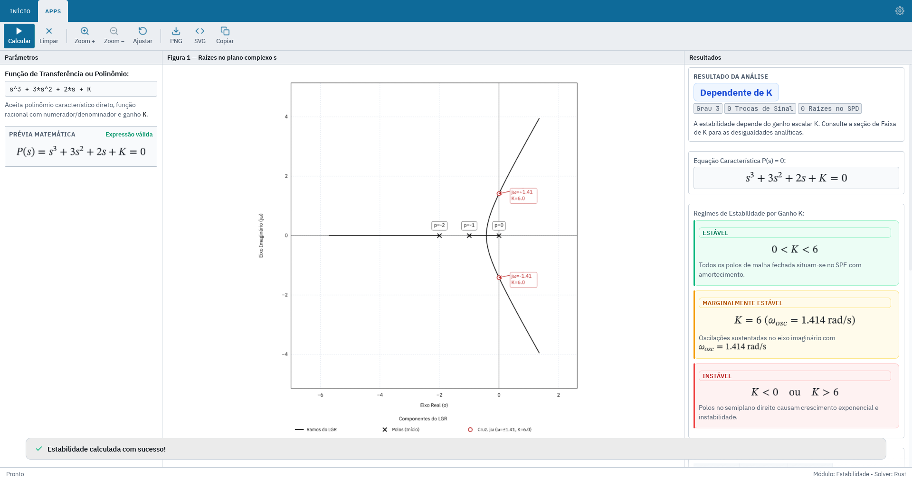
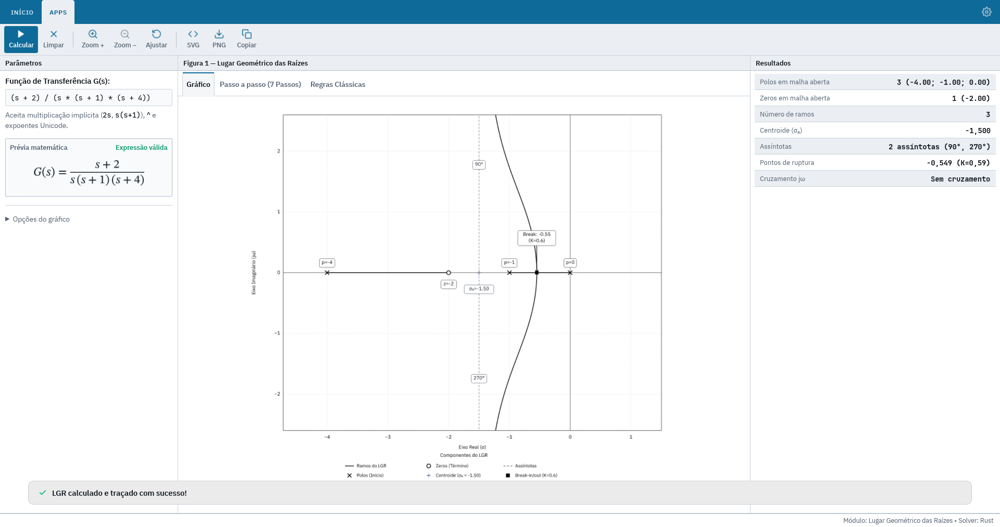
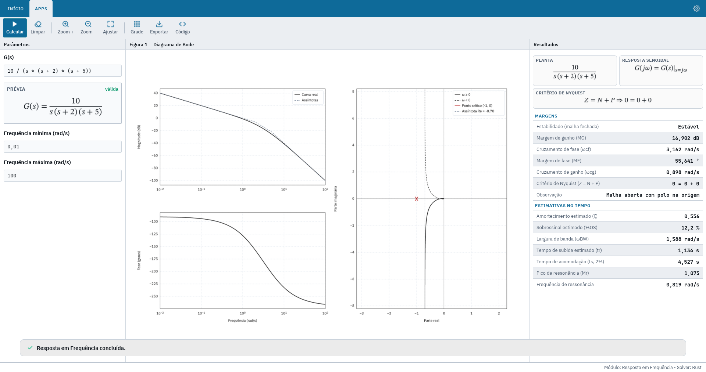
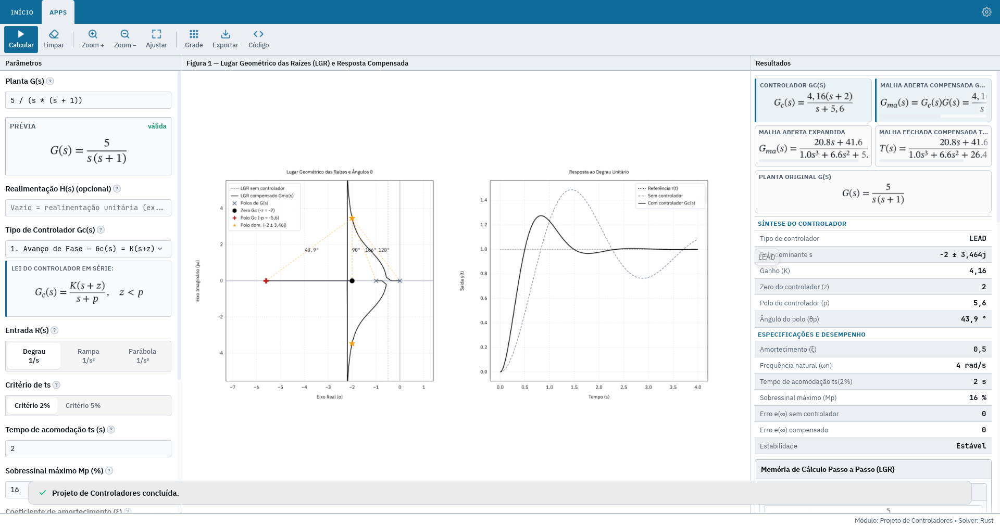
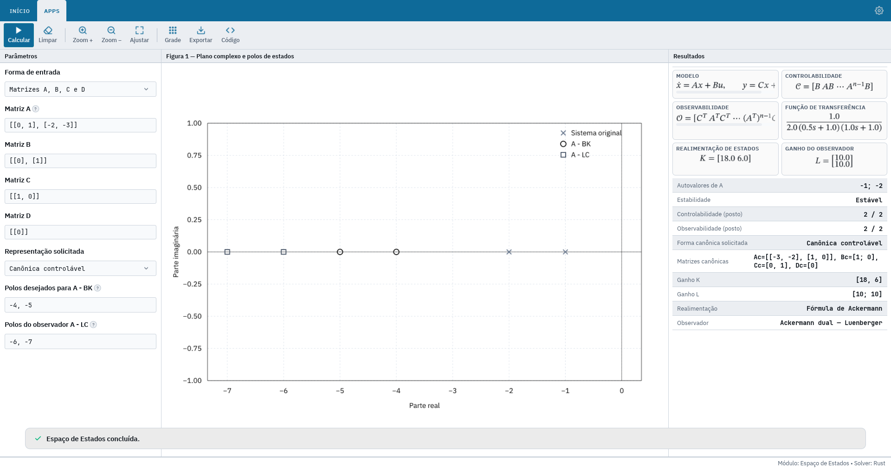

<h1>
  
  ControLAB
</h1>

> [!WARNING]
> O ControLAB ainda está em desenvolvimento. Os valores calculados podem conter erros e devem ser verificados antes de qualquer uso.

Software para análise, simulação e projeto de **Sistemas de Controle**, desenvolvido em **Rust** com interface nativa em **egui/eframe**.

<p align="center">
  <a href="docs/screenshots/01-studio.png">
    
  </a>
</p>

---

## Funcionalidades

- **Análise Linear:** Resposta no tempo, estabilidade (Routh-Hurwitz), Lugar Geométrico das Raízes e resposta em frequência (Bode e Nyquist).
- **Controle & Espaço de Estados:** Projeto de controladores (síntese clássica via LGR, refinamento numérico por restrições temporais/modais e seleção automática) com verificação explícita de conformidade, além de modelagem em espaço de estados.
- **Diagrama de Blocos:** Edição visual e redução de diagramas de blocos.
- **Studio `.m`:** Interpretador e editor de scripts integrado (`mscript`).
- **Exportação & Visualização:** Gráficos interativos, renderização de fórmulas e exportação para PNG/SVG.

## Validação Científica e Numérica

O motor computacional nativo em **Rust** (`controlab-engine`, `blocklab-core`, `mscript`, `controlab-native`) passou por validação científica, numérica, funcional, visual e de desempenho documentada em [`docs/validation/`](docs/validation/README.md):

- **Arquitetura modular 100% Rust:** sem dependências de execução Python ou MATLAB/Simulink na aplicação ou na suíte permanente de testes.
- **Validação independente com MATLAB R2022b (nos casos testados):** 19 casos de Lugar Geométrico das Raízes (`Exercicios_-_LGR.pdf`), 9 questões de Projeto de Controladores (`Projeto_de_controladores.pdf`, 42 configurações auditadas) e 3 suítes opt-in ao vivo do interpretador `mscript` (erro relativo escalado máximo `7,883e-15`).
- **Paridade histórica congelada:** `152/152` casos aprovados frente às referências do motor Python legado (`cargo run --release -p xtask -- parity`).
- **Síntese clássica e refinada com verificação de conformidade:** preserva o projeto didático clássico por LGR (`lgr_classic`) e disponibiliza síntese por restrições (`temporal_refined` e `auto_simplest`) com checagem de estabilidade externa/interna, amortecimento ($\xi$), frequência natural ($\omega_n$), dominância modal, sobressinal real ($M_p$), tempo de acomodação definitivo ($t_s$), erro estacionário e diagnóstico de inviabilidade matemática.
- **Benchmarks reproduzíveis (Rust `--release` vs Python legado `be79347`):** aceleração mediana entre **3,76× e 15,50×** (9,01× em síntese de controladores, 12,89× em LGR e 15,50× na suíte completa de 19 LGRs) e redução de pico de memória RSS de até **11,47×**, medidos em processo persistente JSON-lines com 3 aquecimentos e 5 a 25 iterações em Linux (`Intel Core i5-13420H`). Os ganhos referem-se especificamente às cargas de trabalho medidas — ver metodologia completa em [`docs/validation/benchmarks.md`](docs/validation/benchmarks.md).

Consulte a documentação completa em [`docs/validation/README.md`](docs/validation/README.md), [`docs/validation/methodology.md`](docs/validation/methodology.md), [`docs/validation/academic-validation.md`](docs/validation/academic-validation.md), [`docs/validation/synthesis-comparison.md`](docs/validation/synthesis-comparison.md) e [`docs/validation/final-acceptance.md`](docs/validation/final-acceptance.md).

## Interface e Módulos

| | |
|:---:|:---:|
|  |  |
| **Studio .m & Command Window** | **Central de Módulos (Apps)** |
|  |  |
| **Diagrama de Blocos** | **Resposta no Domínio do Tempo** |
|  |  |
| **Análise de Estabilidade (Routh-Hurwitz)** | **Lugar Geométrico das Raízes (LGR)** |
|  |  |
| **Resposta em Frequência (Bode & Nyquist)** | **Projeto de Controladores** |
|  | |
| **Espaço de Estados** | |

## Como Executar

### Pré-requisitos
- [Rust & Cargo](https://www.rust-lang.org/) instalados.
- Bibliotecas gráficas para compilação com `eframe` (no Linux: drivers gráficos, Wayland/X11, libxkbcommon).

### Execução

```bash
# Clonar o repositório
git clone https://github.com/enthonyaraujo/controLAB.git
cd controLAB

# Compilar e executar
cargo run --bin controlab

# Ou em modo otimizado
cargo run --release --bin controlab
```

> **Dica:** Você também pode usar o script `./run.sh`.

## Como Contribuir

Contribuições são muito bem-vindas! Para contribuir:

1. Faça um **Fork** do repositório.
2. Crie uma branch para a sua alteração:
   ```bash
   git checkout -b feat/minha-feature
   ```
3. Faça o commit das suas mudanças:
   ```bash
   git commit -m "feat: adiciona minha feature"
   ```
4. Envie para o seu fork:
   ```bash
   git push origin feature/minha-feature
   ```
5. Abra um **Pull Request**.

Antes de enviar, verifique se os testes e o padrão de código passam:
```bash
cargo test --workspace
cargo fmt --all --check
```

## Licença

Distribuído sob a licença [MIT](LICENSE).
