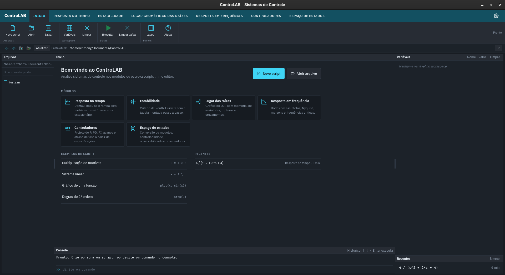
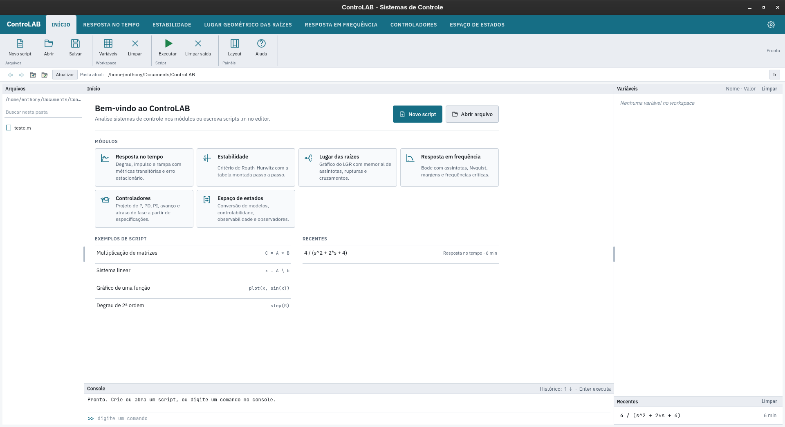

> **Native migration in progress:** this branch uses Rust + egui/eframe. Run `cargo build --offline` and `cargo run --offline` or `./run.sh`. See [native/README.md](native/README.md) and [native Android](native/ANDROID.md). The Electron documentation below describes the previous implementation.

#  <strong>ControLAB — Control Systems Suite</strong>

**English** | [Português (Brasil)](README.pt-BR.md)

[](https://www.python.org/)
[](https://www.electronjs.org/)
[](https://katex.org/)
[](LICENSE)


---

<p align="center">
  <a href="docs/screenshots/preview_dark.png">
    
  </a>
  <br>
</p>

<p align="center">
  <a href="docs/screenshots/preview_white.png">
    
  </a>
  <br>
</p>

---

## Installation and Download

To get the latest version, visit the [GitHub Releases](https://github.com/enthonyaraujo/controlab/releases) page and download the package corresponding to your operating system:

- **Windows:** Standalone installer (`.exe`, NSIS). Installs the application directly on the operating system, creates shortcuts on the Desktop and in the Start Menu, and provides native uninstallation support through the Control Panel.
- **Linux:** Native packages for Debian/Ubuntu (`.deb`), Fedora/Red Hat/openSUSE (`.rpm`), and a standalone universal package (`.AppImage`).
- **Android:** Native application compiled as an `.apk` package, featuring an embedded Python engine powered by Chaquopy, allowing fully offline operation on smartphones and tablets.

---

## Development and Project Structure

- `src/python/`: Canonical source files for the mathematical engines, utilities, JSON bridge, and web server.
- `src/main/`, `src/preload/`, and `src/renderer/`: Electron application and interface shared with the Web and Android versions.
- `android/app/src/main/python/`: Copies used by Chaquopy, synchronized through `node scripts/sync-mobile.js`. Make changes to the original files in `src/python/`.
- `scripts/`: Application execution, synchronization, packaging, and validation scripts.
- `tests/`: Python and renderer tests.
- `docs/test-systembars/`: Android test matrix evidence generated by `scripts/test-systembars-matrix.js`, with results stored in `resultado-matriz.json`.

Once the dependencies are installed, run `npm start` to launch Electron, `npm run web` to launch the browser version, or `npm run web:mobile` to enable access over the local network.

Run `npm test` to execute JavaScript checks and Python tests. The `scripts/run-python.js` runner adds `src/python/` to `PYTHONPATH`, including for test subprocesses.

To run the tests directly on Linux, use:

`PYTHONPATH=src/python .venv/bin/python -m unittest discover -s tests`

The Routh-Hurwitz CLI remains available through:

`node scripts/run-python.js src/python/routh_hurwitz.py "s^2 + 3*s + 2"`

Or:

`./run.sh --cli "s^2 + 3*s + 2"`

The previous Streamlit/Tkinter interfaces and interactive launcher have been removed.

## .m Script Editor and Execution

The home screen provides a file browser, a tabbed editor with syntax highlighting, a console, a variable workspace, and figure visualization.

Open a `.m` file from the current directory or by clicking **Open**. Save changes using **Save**. Press **F5** to execute the active document.

The console preserves variables within the same session. For example, after executing `A=[1 2;3 4];`, enter `det(A)` in the console.

**Clear** removes all session variables, while **Clear Output** clears only the console output.

Commands such as `plot(x,y)` and `step(G)` generate figures that can be exported as SVG files.

The directory navigation toolbar provides **Back**, **Forward**, **Up One Level**, and **Select Folder** controls, along with options to refresh and edit the current path.

Keyboard shortcuts:

- **Alt+← / Alt+→:** Navigate backward and forward through directory history.
- **Alt+↑:** Move up one directory level.

In Electron, folder selection uses the native operating system dialog. In the Web version, the folder selector navigates through directories exposed by the local backend.

The execution engine is an independent copy of the openMAT Rust core, located in `vendor/openmat/`, with its license and provenance documented in that directory.

The original openMAT project directory is not required to build or run ControLAB.

During development, Rust and Cargo are required to compile the engine, in addition to the existing Python and Node.js dependencies:

```bash
npm run build:openmat
npm start

# Alternatively, run in the browser with the local backend:
npm run web
```

The initial build may need to resolve Rust dependencies specified in `Cargo.lock`. Once the dependencies are cached, offline compilation is available using:

`npm run build:openmat -- --offline`

The executable is generated in `build/runtime/` and bundled with the desktop application packages.

Users installing prebuilt releases do not need Rust.

On Windows, close the application before updating an executable that is currently in use.

### Testing and Validation

Run `npm test` to compile the engine and execute JavaScript and Python validation checks.

Run `npm run test:studio:browser` to test the editor workflow using an isolated local server and the Chromium installation already provided by Puppeteer.

The browser test does not install additional browsers.

### Current Implementation and Limitations

`.m` scripts run in Electron, in the Web version with a local backend, and on Android.

On Android, the engine is compiled with the Android NDK for `arm64-v8a` and `x86_64` and bundled in the APK as `libcontrolab_runtime.so`, so scripts run fully offline. Figures are displayed inside the editor. The scientific Python modules continue to operate independently.

The interpreter supports the MATLAB language subset documented in `vendor/openmat/README.md`.

Scripts are limited to **1 MiB**, and execution is subject to time, workload, logical memory, and event limits.

Variables remain available throughout the active session but are not automatically restored after the application is closed.