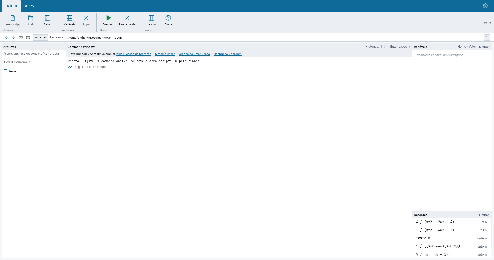
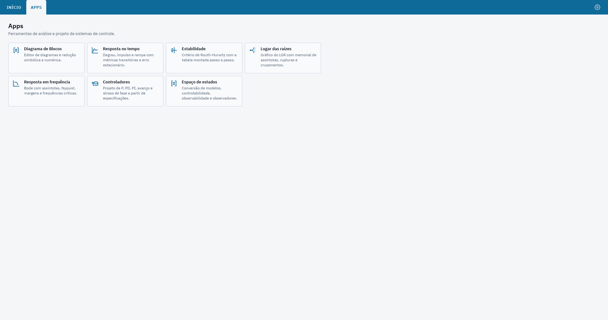
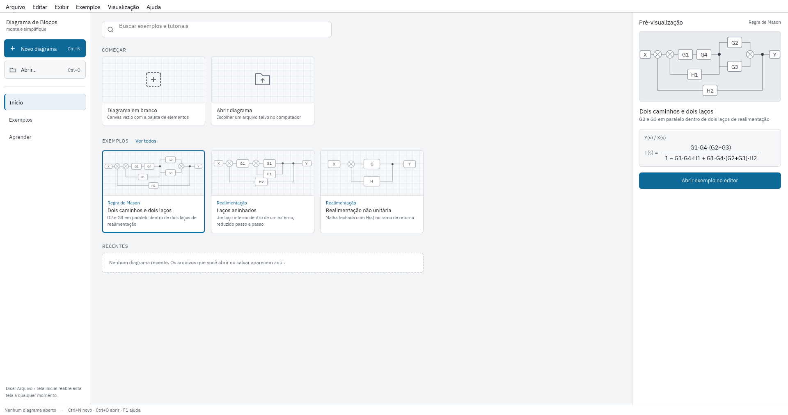
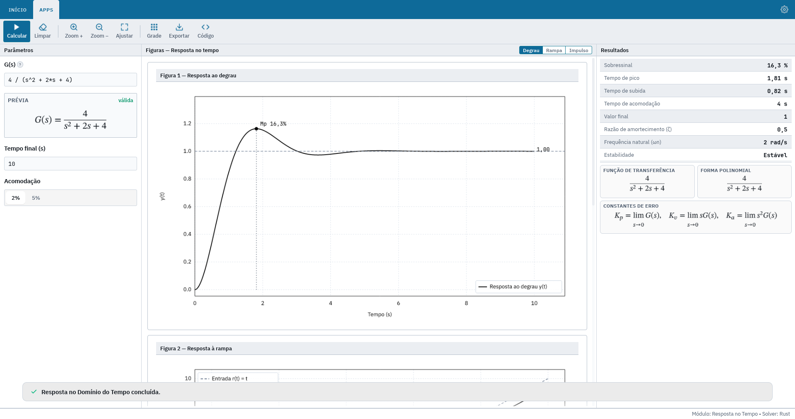
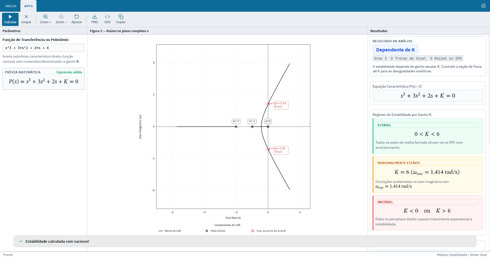
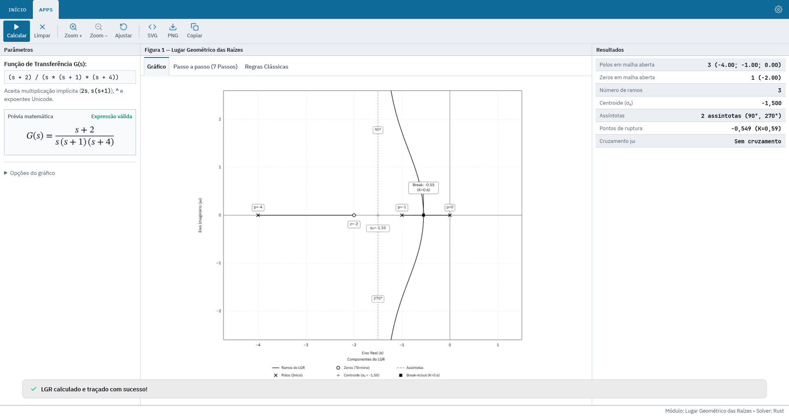
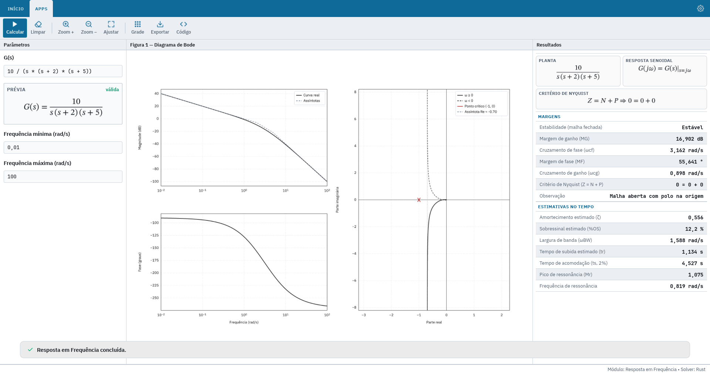
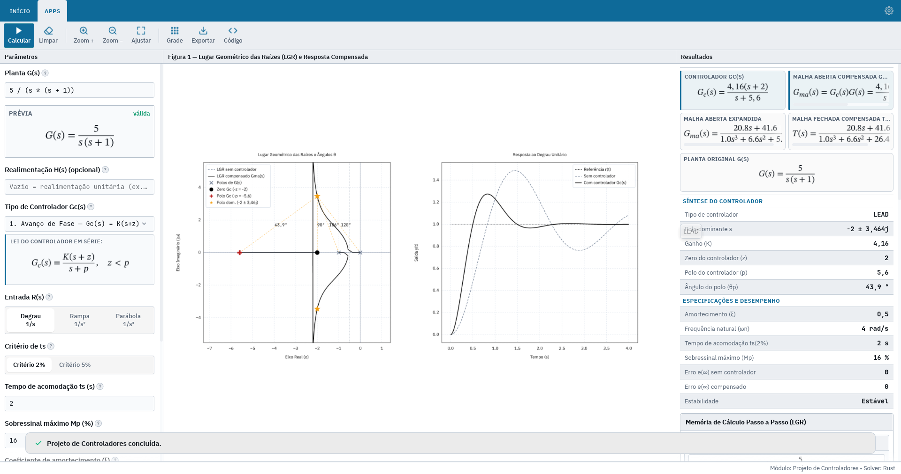
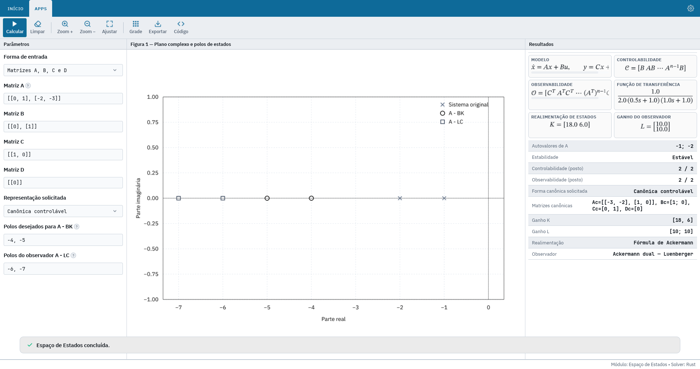

<h1>
  
  ControLAB
</h1>

[🇧🇷 Português](README.md) | [🇺🇸 English](README_EN.md)

Software for the analysis, simulation, and design of **Control Systems**, developed in **Rust** with a native **egui/eframe** interface.

<p align="center">
  <a href="docs/screenshots/01-studio.png">
    
  </a>
</p>

---

## Features

- **Linear Analysis:** Time-domain response, stability analysis (Routh-Hurwitz), Root Locus, and frequency response (Bode and Nyquist).
- **Control & State-Space:** Controller design and state-space modeling.
- **Block Diagrams:** Visual editing and reduction of block diagrams.
- **`.m` Studio:** Integrated script interpreter and editor (`mscript`).
- **Export & Visualization:** Interactive plots, mathematical formula rendering, and PNG/SVG export.

## Interface & Modules

ControLAB provides a modern, responsive, and native desktop interface designed for analytical calculation, dynamic simulation, and controller synthesis. Explore the application screens and analysis modules below (click on any image to open in high resolution):

### 1. `.m` Studio & Command Window
Integrated environment featuring an interactive command line, workspace variable inspection, and `.m` script execution powered by the `mscript` interpreter.

<p align="center">
  <a href="docs/screenshots/01-studio.png">
    
  </a>
</p>

### 2. Applications Hub
Central launchpad offering quick access to all linear control system analysis and design tools.

<p align="center">
  <a href="docs/screenshots/02-apps-hub.png">
    
  </a>
</p>

### 3. Block Diagrams
Visual block diagram editor and viewer featuring automated reduction, Mason's Gain Formula computation, and closed-loop transfer function derivation.

<p align="center">
  <a href="docs/screenshots/03-block-diagram.png">
    
  </a>
</p>

### 4. Time-Domain Response
Transient and steady-state simulation for step, ramp, and impulse inputs, with automated computation of transient metrics (overshoot $\%OS$, peak time $t_p$, rise time $t_r$, and settling time $t_s$) and steady-state error constants ($K_p, K_v, K_a$).

<p align="center">
  <a href="docs/screenshots/04-time-response.png">
    
  </a>
</p>

### 5. Stability Analysis
Stability assessment via parametric Routh-Hurwitz criterion as a function of gain $K$, identification of stability regimes (stable, marginally stable, and unstable), and root mapping in the complex $s$-plane.

<p align="center">
  <a href="docs/screenshots/05-stability.png">
    
  </a>
</p>

### 6. Root Locus (LGR)
Evans root locus plotting displaying open-loop poles, zeros, asymptotes with centroid ($\sigma_a$), breakaway/break-in points, classical rules, and step-by-step derivation.

<p align="center">
  <a href="docs/screenshots/06-root-locus.png">
    
  </a>
</p>

### 7. Frequency Response (Bode & Nyquist)
Asymptotic and exact Bode plots (magnitude in dB and phase in degrees) and complete Nyquist polar plots, featuring exact gain margin ($GM$) and phase margin ($PM$) calculations, crossover frequencies, and time-domain performance estimates.

<p align="center">
  <a href="docs/screenshots/07-frequency-response.png">
    
  </a>
</p>

### 8. Controller Design
Analytical synthesis of classical compensators and controllers (Phase Lead, Phase Lag, P, PD, PI, PID), featuring simultaneous compensated root locus visualization, step response comparison before and after compensation, and detailed calculations.

<p align="center">
  <a href="docs/screenshots/08-controllers.png">
    
  </a>
</p>

### 9. State-Space Representation
Continuous-time state-space matrix modeling $(\mathbf{A}, \mathbf{B}, \mathbf{C}, \mathbf{D})$, canonical form transformations, controllability and observability rank tests, pole placement state feedback $(\mathbf{A} - \mathbf{B}\mathbf{K})$ via Ackermann's formula, and Luenberger observer design.

<p align="center">
  <a href="docs/screenshots/09-state-space.png">
    
  </a>
</p>

## Getting Started

### Prerequisites

- [Rust & Cargo](https://www.rust-lang.org/) installed.
- Graphics libraries required for `eframe` compilation (on Linux: graphics drivers, Wayland/X11, and libxkbcommon).

### Running the Application

```bash
# Clone the repository
git clone https://github.com/enthonyaraujo/controLAB.git
cd controLAB

# Build and run
cargo run --bin controlab

# Or run in optimized release mode
cargo run --release --bin controlab
```

> **Tip:** You can also use the `./run.sh` script.

## Contributing

Contributions are always welcome! To contribute:

1. **Fork** the repository.
2. Create a new branch for your changes:
   ```bash
   git checkout -b feat/my-feature
   ```
3. Commit your changes:
   ```bash
   git commit -m "feat: add my feature"
   ```
4. Push your changes to your fork:
   ```bash
   git push origin feat/my-feature
   ```
5. Open a **Pull Request**.

Before submitting, make sure all tests pass and the code follows the project's formatting standards:

```bash
cargo test --workspace
cargo fmt --all --check
```

## License

Distributed under the [MIT License](LICENSE).
