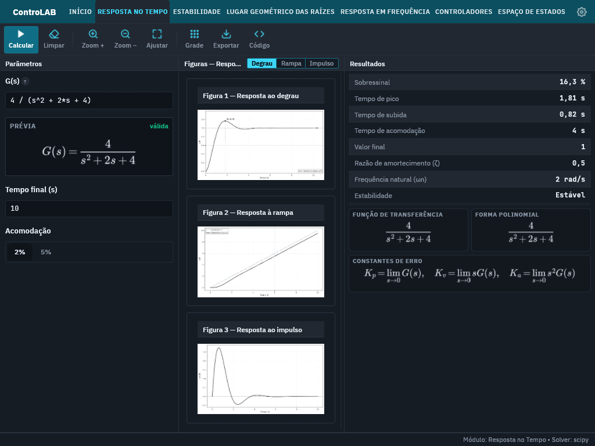

# Remoção da interface web e validação Linux

Validado em 2026-10-28, na branch `enthony/migrate-rust`, em Linux x86_64 com
glibc 2.43. O usuário autorizou remover a implementação web e restringiu esta
etapa de validação ao Linux.

## Estado implementado

- Interface Rust/egui/eframe; cálculos científicos Python; sessão `.m` no mesmo
  núcleo Rust/openMAT vendorizado, sem mudanças nas suas fontes.
- Removidos Electron, renderer, preload, servidor Web Python, projeto Android
  Capacitor, dependências Node e scripts/testes JS. Não existem fontes
  JS/JSX/TS/TSX/MJS/CJS, HTML ou CSS na árvore de aplicação.
- Os 27 arquivos TTF usados foram comparados por SHA-256 com os originais do
  renderer e preservados byte a byte em `assets/fonts`. IBM Plex Sans,
  JetBrains Mono, ícones e identidade visual foram mantidos. KaTeX fornece
  apenas fontes TTF ao MathText, sem runtime JavaScript.
- `assets/` contém os recursos canônicos e as licenças; seu manifesto registra
  hashes. O catálogo recebeu instruções Cargo/Gradle em substituição a npm.
- A engine resolve recursos no checkout, no pacote PyInstaller ou no pacote de
  dados Android, sem caminhos para o renderer ou Node.
- Cargo compila o workspace. Scripts Python geram e verificam a distribuição
  Linux independente; o workflow atual valida Linux sem Node.

## Evidências executadas

| Verificação | Resultado |
| --- | --- |
| `cargo build --offline --release --workspace` | Aprovado |
| `cargo test --offline --workspace` | 33 testes aprovados: 29 UI/integração e 4 runtime |
| `cargo clippy --offline --workspace --all-targets -- -D warnings` | Aprovado |
| `cargo fmt -p controlab-native -- --check` | Aprovado |
| `PYTHONPATH=src/python .venv/bin/python -m unittest discover -s tests` | 111 testes aprovados |
| Testes de recursos repetidos após atualizar o catálogo | 4 aprovados |
| `python3 scripts/check_native_sources.py` | Sem fontes web ou `node_modules` |
| `bash -n run.sh` e `git diff --check` | Aprovados |
| PyInstaller e pacote Linux em perfil release | Aprovados |
| Engine empacotada fora do diretório do repositório | Seis módulos, fórmulas e sessão `.m` aprovados |
| Interface do pacote, com Python/ponte de desenvolvimento indisponíveis | Janela, gráficos e fórmulas aprovados |
| Manifesto e varredura do pacote | Hashes íntegros; sem arquivos JS/TS/HTML/CSS |

A validação do pacote executa a partir de uma pasta temporária, remove os
overrides de recursos/runtime e `PYTHONPATH`, e aponta o Python/ponte de
desenvolvimento para arquivos inexistentes. Confere prévia de função de
transferência, resposta temporal em inglês, LGR, Routh, frequência,
controladores, espaço de estados, fórmulas e persistência de `a=7; a+2`.
O runtime `.m` é encontrado automaticamente junto à interface.

Para reproduzir o empacotamento, com os requisitos de build já preparados:

```bash
.venv/bin/python scripts/package_native.py --release
env -u WAYLAND_DISPLAY WINIT_UNIX_BACKEND=x11 \
  .venv/bin/python scripts/validate_native_bundle.py dist/native/controlab --ui
```

A saída deve estar vazia; `--output` seleciona outra pasta. Nesta sessão o
pacote final está em `dist/native/controlab`, com aproximadamente 329 MiB.
Execute `dist/native/controlab/controlab` e distribua a pasta inteira.



## Limites

- A validação gráfica usou X11/XWayland. Uma captura com `WAYLAND_DISPLAY`
  presente parou de receber frames em segundo plano; a execução foi encerrada
  e repetida com X11. Não equivale a uma matriz de compositores Wayland.
- O pacote inclui Python e suas bibliotecas, mas exige bibliotecas gráficas do
  sistema e glibc compatível com o host de build. Não foi validado em outra
  distribuição Linux nem convertido em AppImage/DEB/RPM.
- Matplotlib emitiu avisos de substituição de pesos de fonte e python-control
  avisou sobre a futura troca de `root_locus`. PyInstaller avisou sobre
  `scipy.special._cdflib` e bibliotecas Windows opcionais `user32`/`msvcrt`.
  Os seis módulos e a execução gráfica Linux passaram apesar desses avisos.
- `cargo fmt --all -- --check` encontra diferenças preexistentes nas fontes
  vendorizadas. O vendor foi preservado; a formatação da interface passou.
- Android e Windows ficaram fora desta validação por decisão explícita do
  usuário. O bootstrap Android nativo e seus requisitos permanecem para
  continuidade; o pacote de recursos Gradle recente ainda não foi validado.
- O seletor de inglês da UI nativa e a integração Android SAF continuam
  pendentes conforme os registros anteriores. A engine mantém traduções.
- O workflow CI foi atualizado, mas não executado remotamente nesta sessão.
  Nenhum commit, push ou publicação foi realizado.

Ambientes virtuais e caches de ferramentas não são fontes da aplicação e não
entram na varredura de fontes. A distribuição final é verificada separadamente,
incluindo todas as bibliotecas e seus dados; os recursos WebAgg do Matplotlib
são excluídos do pacote.
