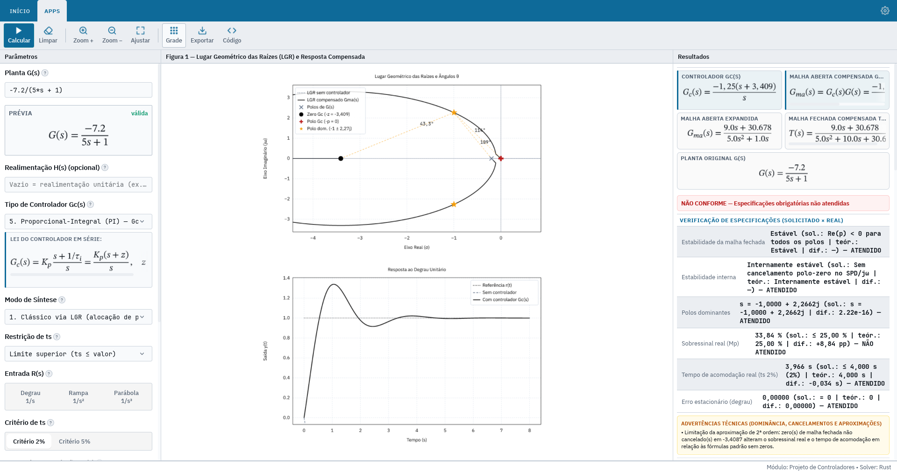
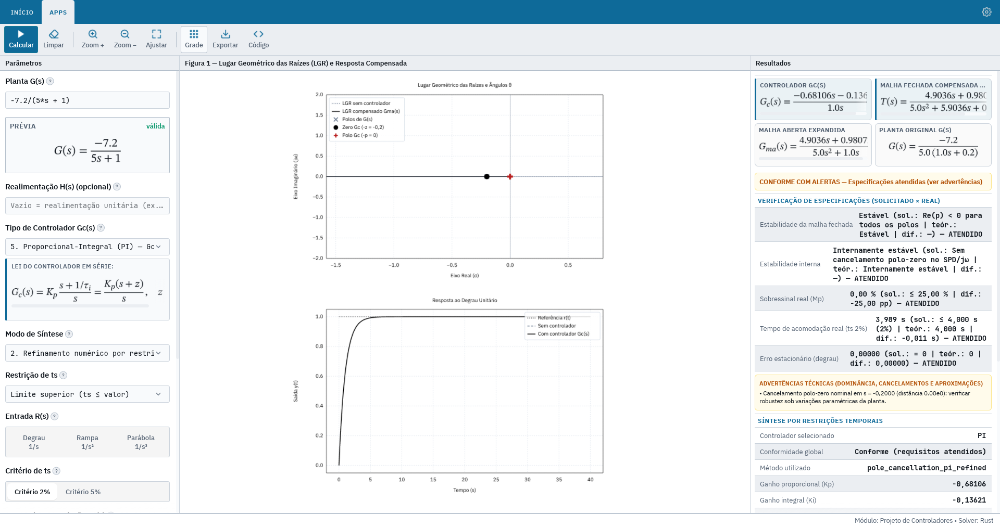
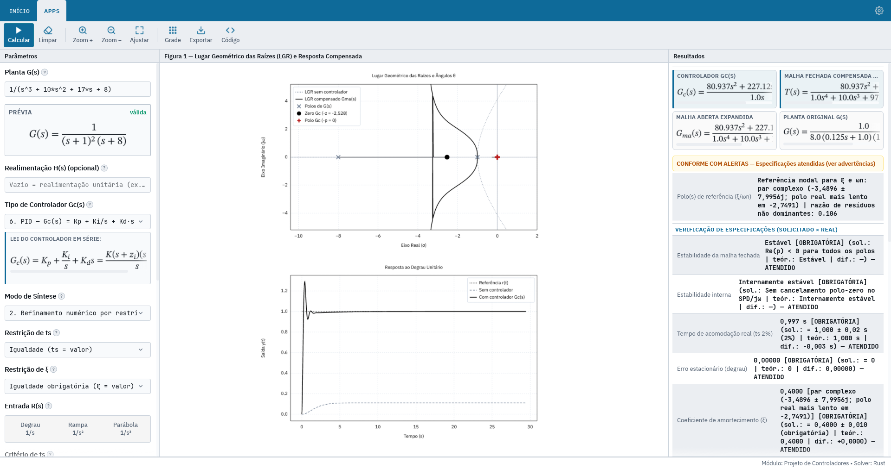
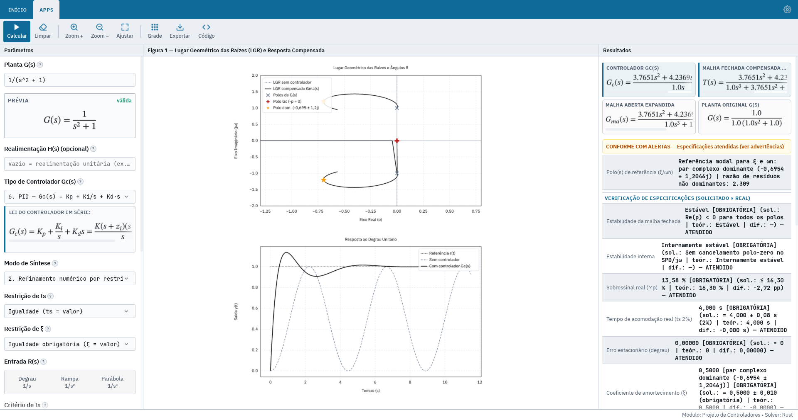

# Comparação de Síntese de Controladores e Provas de Inviabilidade

O módulo de Projeto de Controladores do ControLAB preserva integralmente o método didático clássico via Lugar Geométrico das Raízes (`lgr_classic`) e acrescenta duas modalidades genéricas baseadas em verificação temporal e modal sobre a malha fechada real (`crates/control-engine/src/controller_synthesis.rs`):

1. **`lgr_classic`:** alocação clássica pelas condições de módulo e fase, agora acompanhada de verificação completa de conformidade (`NÃO CONFORME` sempre que restrições obrigatórias forem violadas).
2. **`temporal_refined`:** busca paramétrica determinística + refinamento coordenado e diagonal acoplado sobre a estrutura escolhida (`P`, `PI`, `PD`, `Lead`, `PID`), impondo estabilidade externa/interna, $M_p$, $t_s$, $e_{ss}$, $\xi$ e $\omega_n$ conforme a semântica selecionada. O controlador PID é parametrizado diretamente em ganhos canônicos $[K_p, K_i, K_d]$, abrangendo zeros reais ou complexos conjugados de fase mínima no SPE.
3. **`auto_simplest`:** percorre a hierarquia `P -> PI -> PD -> Lead -> PID`, descarta estruturas algebricamente inviáveis com justificativa matemática explícita e seleciona a estrutura mais simples que satisfaz todas as restrições.

---

## 1. Comparação Antes (`lgr_classic`) × Depois (`temporal_refined` / `auto_simplest`)

| Caso | Modo | Ganhos ($K_p, K_i, K_d$) | $\xi$ calculado [polo/par] | $M_p$ (Rust / MATLAB) | $t_s(2\%)$ (Rust / MATLAB) | $e_a(\infty)$ | Conformidade |
|---|---|---|---:|---:|---:|---:|---|
| **Q2 PD** | Clássico LGR | `3.0, 0, 2.0` | `0.5000` (`-1 ± 1.732j`) | `41.26%` / `41.25%` | `3.723 s` / `3.723 s` | `0.250` | **FAIL** ($M_p, t_s$) |
| **Q2 PD** | Refinado ($\xi \ge 0{,}5$) | `6.914, 0, 14.286` | `1.0000` (polos reais) | `15.51%` / `15.51%` | `4.000 s` / `4.000 s` | `0.126` | **PASS*** ($\xi \ge 0{,}5$) |
| **Q2 PID** | Clássico `equal` | `3.737, 1.474, 2.369` | `0.5000` (polo lento `-0.369`) | `13.99%` / `13.97%` | `7.639 s` / `7.639 s` | `0.000` | **FAIL** ($t_s$) |
| **Q2 PID** | **Refinado ($\xi = 0{,}5$ exato)** | `4.2369, 4.5933, 3.7651` | **`0.5000`** (par dom. `-0.695 ± 1.205j`) | `13.58%` / `13.56%` | `4.000 s` / `4.000 s` | `0.000` | **PASS*** (todas) |
| **Q5 PID** | Clássico `cancel`/`equal` | `200, 100, 100` | `0.4000` (`-4 ± 9.165j`) | `25.38%` / `25.37%` | `0.841 s` / `0.841 s` | `0.000` | **FAIL** ($t_s \ne 1$) |
| **Q5 PID** | **Refinado ($\xi = 0{,}4$ exato)** | `227.123, 56.865, 80.937` | **`0.4000`** (`-3.490 ± 7.996j`, `res=0.106`) | `28.84%` / `28.84%` | `0.997 s` / `0.997 s` | `0.000` | **PASS*** (todas) |
| **Q7 PD** | Clássico LGR | `1.6, 0, 0.8` | `0.5000` (`-1 ± 1.732j`) | `16.30%` / `16.29%` | `4.038 s` / `4.038 s` | `0.000` | **FAIL** ($M_p > 16\%$) |
| **Q7 PD** | Refinado ($\xi \ge 0{,}5$) | `0.5183, 0, 0.2681` | `0.8941` (`-1.037 ± 0.520j`) | `0.188%` / `0.188%` | `4.000 s` / `4.000 s` | `0.000` | **PASS*** ($\xi \ge 0{,}5$) |
| **Q7 PD** | **Refinado ($\xi = 0{,}50 \pm 0{,}01$ dom.)** | `1.6030, 0, 0.8175` | **`0.5044`** (dom. `-1.020 ± 1.746j`, `res=0.00035`) | `15.95%` / `15.95%` | `3.972 s` / `3.972 s` | `0.000` | **PASS*** (tol. `±0,01`) |
| **Q8 PI** | Clássico LGR | `-1.25, -4.2608, 0` | `0.4037` (`-1 ± 2.266j`) | `33.84%` / `33.84%` | `3.966 s` / `3.965 s` | `0.000` | **FAIL** ($M_p > 25\%$) |
| **Q8 PI** | **Refinado (`auto_simplest`)** | `-0.5022, -0.1263, 0` | `1.0000` (`-0.638, -0.285`) | `1.854%` / `1.854%` | `3.990 s` / `3.992 s` | `0.000` | **PASS*** (todas) |
| **Q8 PI** | Referência independente | `-1.0, -0.2, 0` | `1.0000` ($T=\frac{1{,}44}{s+1{,}44}$) | `0.000%` / `0.000%` | `2.717 s` / `2.717 s` | `0.000` | **PASS*** (todas) |
| **Q9 PD** | Clássico LGR | `4.0, 0, 2.0` | `0.5000` (`-1 ± 1.732j`) | `29.84%` / `29.84%` | `3.753 s` / `3.753 s` | `0.000` | **FAIL** ($M_p > 16\%$) |
| **Q9 PD** | Refinado ($\xi \ge 0{,}5$) | `1.7459, 0, 2.4408` | `0.9236` (`-1.220 ± 0.507j`) | `15.02%` / `15.02%` | `3.990 s` / `3.990 s` | `0.000` | **PASS*** ($\xi \ge 0{,}5$) |

---

## 2. Demonstrações Matemáticas de Inviabilidade (`ProvenInfeasible`)

O algoritmo distingue explicitamente **inviabilidade matematicamente comprovada** (`ProvenInfeasible`) de **ausência de solução nos limites da busca** (`NotFoundWithinSearchBounds`):

1. **Duplo integrador $G(s) = k/s^2$ (Q9) com PD e igualdade $\xi = \xi_0 \in (0,1)$:**
   Com realimentação unitária e $G_c(s) = K_p + K_d s$ ($k K_d = 2\xi_0 \omega_n,\; k K_p = \omega_n^2$), a malha fechada possui ganho estacionário unitário $y(\infty) = 1$ e é estritamente invariante por mudança de escala temporal $u = s/\omega_n$:
   $$T(\omega_n u) = \frac{2\xi_0 u + 1}{u^2 + 2\xi_0 u + 1}$$
   Para $\xi_0 = 0{,}5$, o sobressinal é constante e igual a **$29{,}835\%$** para todo $\omega_n > 0$ — logo é matematicamente impossível atender simultaneamente a $\xi = 0{,}5$ e $M_p \le 16\%$ com um controlador PD.

2. **Oscilador não amortecido $G(s) = k/(s^2 + c)$ com $c > 0$ (Q2: $c = 1$) com PD e igualdade $\xi = \xi_0 \in (0,1)$:**
   Diferentemente do duplo integrador ($c = 0$), a malha fechada com $k K_d = 2\xi_0 \omega_n$ e $c + k K_p = \omega_n^2$ possui **ganho estacionário não unitário**:
   $$T(s) = \frac{2\xi_0 \omega_n s + (\omega_n^2 - c)}{s^2 + 2\xi_0 \omega_n s + \omega_n^2}, \qquad y(\infty) = T(0) = \alpha = 1 - \frac{c}{\omega_n^2}$$
   Qualquer controlador PD estabilizante com rastreamento positivo exige $k K_p > 0 \iff \omega_n^2 > c$, donde $\alpha \in (0, 1)$. Normalizando $T(s)$ pelo seu valor estacionário $y(\infty) = \alpha$ (já que $M_p$ mede o excesso relativo a $y(\infty)$) e aplicando $u = s/\omega_n$:
   $$\tilde{T}(\omega_n u) = \frac{T(\omega_n u)}{y(\infty)} = \frac{\frac{2\xi_0}{\alpha}\, u + 1}{u^2 + 2\xi_0 u + 1} = H_0(u) + \frac{2\xi_0}{\alpha}\, u H_0(u)$$
   No tempo adimensional $\tau = \omega_n t$, a resposta ao impulso $h_0(\tau) = \mathcal{L}^{-1}\{u H_0(u)\} = \frac{1}{\sqrt{1-\xi_0^2}}e^{-\xi_0\tau}\sin(\sqrt{1-\xi_0^2}\,\tau)$ é estritamente positiva em todo o primeiro semiciclo $(0, \pi/\sqrt{1-\xi_0^2})$, incluindo o instante de pico $\tau^*$ do caso $\alpha = 1$. Como $2\xi_0/\alpha > 2\xi_0$ estritamente para todo $\alpha \in (0,1)$, resulta:
   $$M_p(c > 0, \omega_n) > M_p(c = 0) = 29{,}835\% > 16{,}3\% \qquad \forall\,\omega_n > \sqrt{c}$$
   A inclusão de um integrador (PID na Q2 com zeros complexos conjugados no SPE) introduz o grau de liberdade necessário para satisfazer $\xi = 0{,}5$, $M_p \le 16{,}3\%$, $t_s = 4\text{ s}$ e $e_{ss} = 0$ simultaneamente.

3. **Outras inviabilidades algébricas verificadas:** planta Tipo 0 sem integrador para $e_{ss} = 0$ (ex.: `P`/`PD` na Q8) e planta Tipo $\ge 2$ sem zeros finitos com `P`/`PI` (ex.: `P`/`PI` na Q9).

---

## 3. Evidências Visuais Selecionadas da Interface Nativa

| Caso | Captura Real da GUI (`controlab-native`) |
|---|---|
| **Q8 Clássico (`lgr_classic`) — `NÃO CONFORME`** ($M_p = 33{,}84\% > 25\%$, alerta de zero extra) |  |
| **Q8 Refinado (`temporal_refined`) — `CONFORME COM ALERTAS`** ($M_p = 0\%$, $t_s = 3{,}99\text{ s}$) |  |
| **Q5 Etapa 11 — Igualdade obrigatória $\xi = 0{,}4000$, $t_s = 0{,}997\text{ s}$, razão de resíduos `0,106`** |  |
| **Q2 PID Etapa 11 — Igualdade obrigatória $\xi = 0{,}5000$ dominante, $M_p = 13{,}58\%$, $t_s = 4{,}000\text{ s}$** |  |
